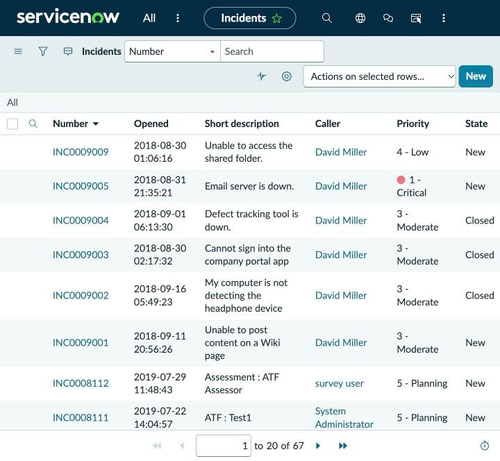
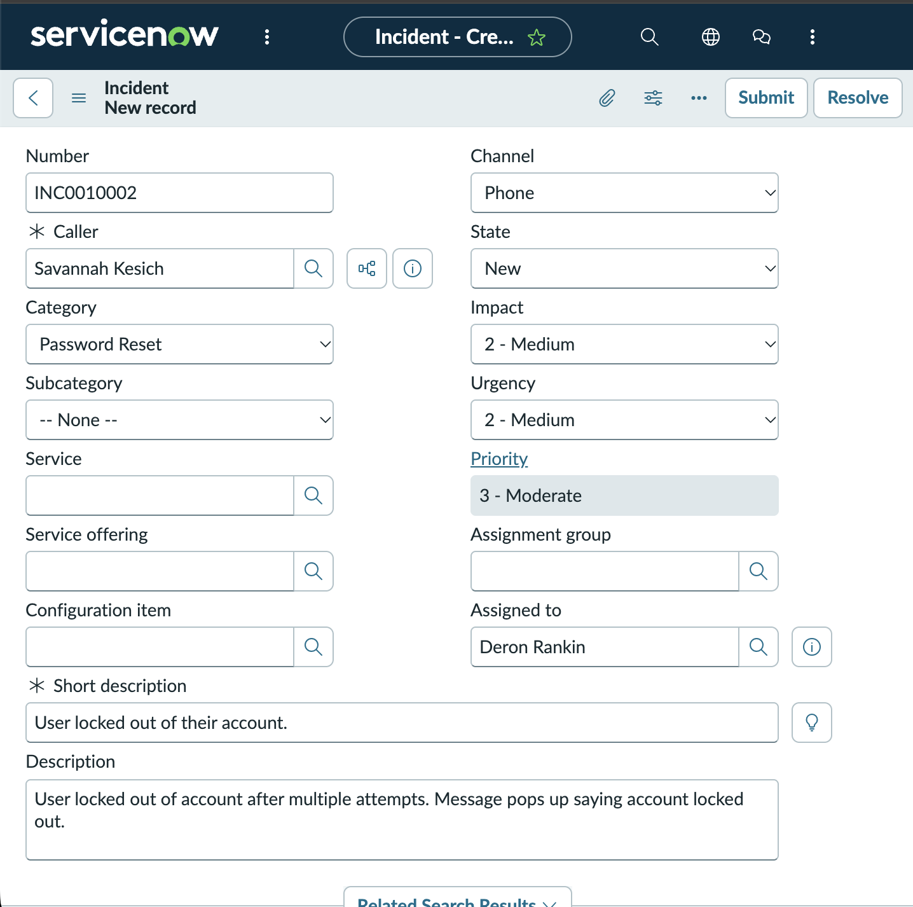
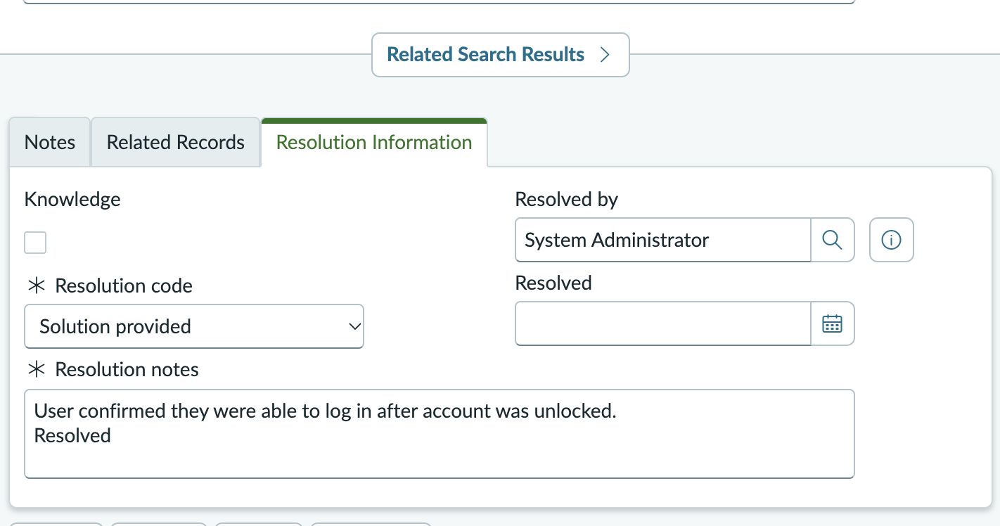
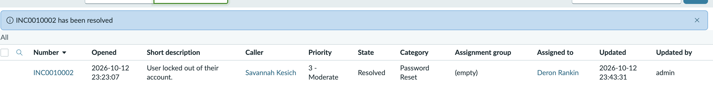

# ServiceNow IT Ticketing Practice Project

A hands-on practice project where I created and resolved a sample IT support incident in ServiceNow, a ticketing platform used by IT help desks. Done in a free ServiceNow developer instance.

## Scenario
A user calls the help desk because they are locked out of their account after multiple failed login attempts.

## What I did
- Opened the Incident list and created a new incident (**INC0010002**).
- Filled in the caller, category (Password Reset), short description, description, channel (Phone), impact (2 - Medium), and urgency (2 - Medium). ServiceNow calculated the priority as **3 - Moderate**.
- Assigned the ticket to myself and submitted it. The ticket moved to **In Progress**.
- Documented the troubleshooting steps in the work notes.
- Resolved the ticket with a resolution code (**Solution provided**) and resolution notes. The ticket state changed to **Resolved**.

## Walkthrough

### 1. Incident list (starting point)
This is the Incidents list in my ServiceNow developer instance before I created anything. It shows the sample tickets that come with the instance. From here I clicked **New** to start a ticket.

### 2. New incident form
I created a new incident for a user locked out of their account. I entered the caller, set the category to Password Reset, wrote a short description and a longer description of what the user reported, set the channel to Phone, and set impact and urgency to Medium. ServiceNow calculated the priority as 3 - Moderate. I assigned the ticket to myself.

### 3. Ticket created and in progress
After I submitted the form, the new ticket (INC0010002) appeared at the top of the incident list with the state **In Progress**, category Password Reset, and my name in **Assigned to**.

### 4. Work notes
I opened the ticket and documented the steps I would take to fix the problem. The notes are written as a plan: unlock the account using Active Directory Users and Computers, find the username, unlock the account, and let the user know to try again once it has been unlocked. The activity stream below shows my note and the field changes ServiceNow tracked.

### 5. Resolve form
When the user confirmed they could log in again, I clicked **Resolve** and filled in the required fields: the resolution code (**Solution provided**) and resolution notes saying the user confirmed they were able to log in after the account was unlocked.

### 6. Resolved ticket
After saving, ServiceNow confirmed that INC0010002 had been resolved, and the ticket in the list shows the state **Resolved**.

## Ticket summary
| Field | Value |
|---|---|
| Ticket number | INC0010002 |
| Category | Password Reset |
| Channel | Phone |
| Impact / Urgency | 2 - Medium / 2 - Medium |
| Priority | 3 - Moderate |
| Short description | User locked out of their account. |
| Final state | Resolved |

## What I learned
- **Ask questions first.** Good ticket handling starts with asking the user what is happening, so the description and notes are accurate and the right fix is clear.
- **Multitasking.** Working a ticket means keeping several things in view at once: the form fields, the notes, the priority, and the next step for the user.
- **It was simpler than I expected.** The basic incident workflow is easy to follow once you know where each field and step is, and clear documentation makes the ticket useful to the next technician.

## Next steps
- Create more sample tickets for other common issues, such as Wi-Fi problems and printer jams.
- Practice setting different priorities using impact and urgency.
- Continue working toward CompTIA Network+ alongside this hands-on practice.

## About me
Deron Rankin | CompTIA A+ | B.S. Cybersecurity & Information Assurance (in progress), Western Governors University
[LinkedIn](https://www.linkedin.com/in/deronrankin)
